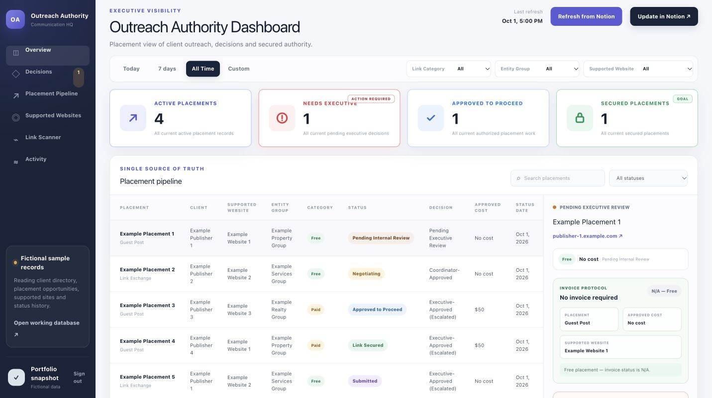
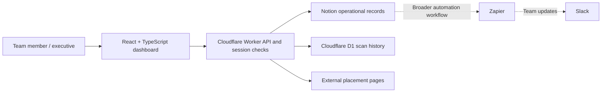

# Executive Outreach Dashboard

A sanitized source-code portfolio of an executive dashboard developed independently by **John Carlo Jondonero** for XGrowth. Shared with permission. All included records are fictional; client identities, private workspace links, account configuration, credentials, and production artifacts are excluded.



## The problem

The founder wanted a clear view of outreach performance, pending decisions, and delivery progress with very little software spend. The initial idea was broad. My responsibility was to turn it into requirements, choose a workable scope, and build a system that fit the team's existing workflow and resources.

## What I built

- A React dashboard showing placements, performance indicators, activity history, and an executive action queue.
- Filters and detail views for campaign progress, ownership, commercial terms, and next actions.
- Backend workflows for executive review, invoice status, and Notion updates.
- A secured-link scanner with shared scan history and persisted manual resolutions.
- Session-based access checks and role-specific actions in the Cloudflare Worker.

## My role

I independently led scoping, workflow design, tool selection, AI-assisted implementation, and iterative refinement. I translated the founder's broad request into an operating tool, directed the AI-assisted build, and reviewed behavior against business requirements. AI accelerated implementation; prioritization, trade-offs, and responsibility for the result remained mine.

## Tools and architecture



The project used ChatGPT Plus for AI-assisted development. The operating stack was designed around free Notion, Cloudflare, and Slack accounts, with Zapier and ChatGPT Plus as the paid tools. Actual usage must remain within each provider's limits. The Zapier and Slack automation configurations are outside this repository; this code contains the dashboard, Worker, schema, and review tests.

## Design trade-offs

- **Use the existing workspace:** Notion stays the operational record rather than introducing a second editing system. API limits, pagination, and property mapping become implementation considerations.
- **Spend selectively:** Cloudflare serves the interface and backend; D1 persists scanner state. Keeping the solution small reduces overhead but does not remove quota and maintenance constraints.
- **Keep decisions visible:** Executive approvals and invoice states are explicit workflow steps. The review tests check comment preservation, write ordering, and retry behavior.
- **Treat scans as evidence:** A scan can be inconclusive; manual verification and shared resolutions remain part of the workflow.
- **Separate portfolio from production:** This snapshot uses fictional records, generic role labels, and placeholder configuration. It is a code demonstration, not a copy of the employer's live environment or a production security certification.

## Run the fictional-data interface

Requires Node.js 22.13 or later and npm.

```sh
npm ci
npm run dev
```

Open the local URL printed by Vite. The interface starts with fictional fallback records. The Vite server does not supply the private Worker API; live synchronization, authenticated actions, and scanning need a separately configured backend. No production access is needed for source review or the fictional-data interface.

```sh
npm run typecheck
npm test
npm run build
npm run check:sanitization
```

## Review the code

| File | Purpose |
| --- | --- |
| `app/Dashboard.tsx` | Executive overview, filters, placement details, and review UI |
| `app/SecuredLinkScanner.tsx` | Scan results and manual verification interface |
| `cloudflare/worker.ts` | Session handling, Notion integration, review actions, and scanner API |
| `lib/outreach-data.ts` | Shared types and entirely fictional records |
| `migrations/` | D1 tables for scan history and persistent resolutions |
| `tests/executive-review.test.mjs` | Existing review-flow regression tests with synthetic fixtures |
| `wrangler.example.jsonc` | Placeholder deployment configuration |

A backend deployment requires a separate Notion workspace matching the property mappings, a new D1 database, and secrets supplied through Cloudflare's secret storage. Review the role configuration before any deployment. This portfolio does not include deployment credentials or a deploy script. See [sanitization notes](docs/SANITIZATION.md).

## Project context

[Professional portfolio](https://portfolio-jcjondonero.pages.dev/) · [Original live tool (authorized access required)](https://outreach-authority-dashboard.xgrowth-ops.workers.dev/)

No performance uplift or financial savings are asserted without measured evidence. Source visibility is provided for evaluation; no open-source license or rights to reuse employer-owned work are granted.
